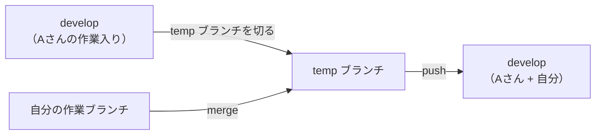
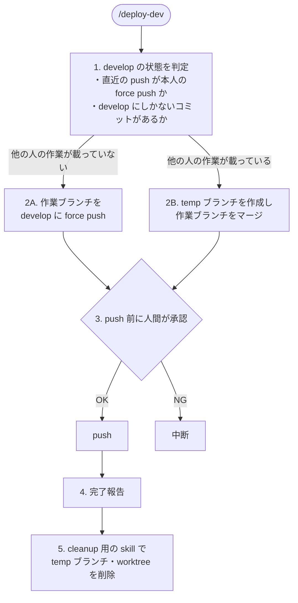

## テーマ

チームで共有しているdevelopブランチ更新時、作業中の方の資産を壊さずに更新する手法をskill化したら開発体験が大分上がったのでその話になります。

## ブランチ戦略

私たちのチームでは、開発時主に下記2 つのブランチを使っています。

| ブランチ | 役割 | ルール |
| --- | --- | --- |
| develop | クラウド環境つきで、試験的に動作確認できる場所 | 自由に壊して OK。force push も可 |
| main | そのまま stg / prd に反映される | 人間の承認がある PR を出さないとマージできない |

developは自由に壊していい場所ですが、チーム全員で1つの環境を共有している点競合には気をつける必要がありました。

## 課題
### temp ブランチで「上積み」する運用
develop は force push できますが、他の誰かが 動作確認中だった場合、その人の変更を消してしまいます。
なので、誰かが作業中のときは temp ブランチを経由して上積みする運用にしています。

こうすることで、他の人の変更を残したまま、自分の変更を載せることができます。

### 上記を毎回手動でやるのが面倒だった

競合は防げるものの、developを更新するたびに下記作業が発生していました。

1. 最新の develop を pull する
2. 他の人の作業が載っているかを確認する
3. 載っていれば develop から temp ブランチを作る
4. temp ブランチに自分の作業ブランチをマージする
5. 競合があれば解消する
6. develop に push する
7. temp ブランチを削除する

これを、開発中に何度も繰り返すと大分開発体験が悪いです。
今までskill化するという発想がなぜか浮かばず手動で行なっておりました。

## 解決策：`/deploy-dev` skill

上記のフローを丸ごと Claude Code の skill にして、`/deploy-dev` で呼び出せるようにしました。

### 全体の流れ

### 1. develop の状態を判定する

最初に、今の develop に他の人の作業が載っているかを判定します。

- 直近の push が本人の force push か：自分が最後に force push したのであれば、develop は自分の状態のまま
- develop にしかないコミットがあるか：作業ブランチに含まれないコミットがあれば、他の人の変更が載っている

この結果によって、次の 2 パターンのどちらで更新するかを決めます。

### 2A. 作業ブランチを force push する

他の人の作業が載っていなければ、気にせず上書きして問題ないので作業ブランチを develop にそのまま force push します。余計なマージコミットが増えず、develop がきれいな状態に保たれます。

### 2B. temp ブランチ経由でマージして push する

他の人の作業が載っている場合は、前述の temp ブランチ運用を行います。

1. develop から temp ブランチを作成する
2. temp ブランチに作業ブランチをマージする
3. develop に push する

temp ブランチは worktree 上で作業するため、手元の作業ディレクトリを汚さずに済みます。

### 3. push 前には必ず人間が承認する

A・B どちらのパターンでも、push の前に必ず人間の承認を挟むようにしています。

判定や操作は skill に任せつつ、「本当に push してよいか」の最終判断は人がする、という役割分担にしてます。

### 4. 完了報告

push が終わったら、どちらのパターンで何を反映したかを報告します。

### 5. cleanup は別の skill に分ける

temp ブランチと worktree の削除は、cleanup 用の skill として別に用意し、作業完了後にそちらを呼び出す形にしました。

## 導入効果

develop を更新したいときは、チームにアナウンスして `/deploy-dev` を実行するだけになりました。これまで手作業で行っていた 6〜7 ステップが不要になり、開発体験が大分向上しました。

なぜもっと早く思いつかなかったのかとすごく思います。。

## おわりに

普段の業務の中には、意外と自動化・簡略化できるところが潜んでいると改めて感じました。

毎回やっているけど、ちょっと面倒な作業はskill化や自動化しようという意識を明確に持たないと意外と気付いてないところに改善余地があるのだなというのが学びでした。
