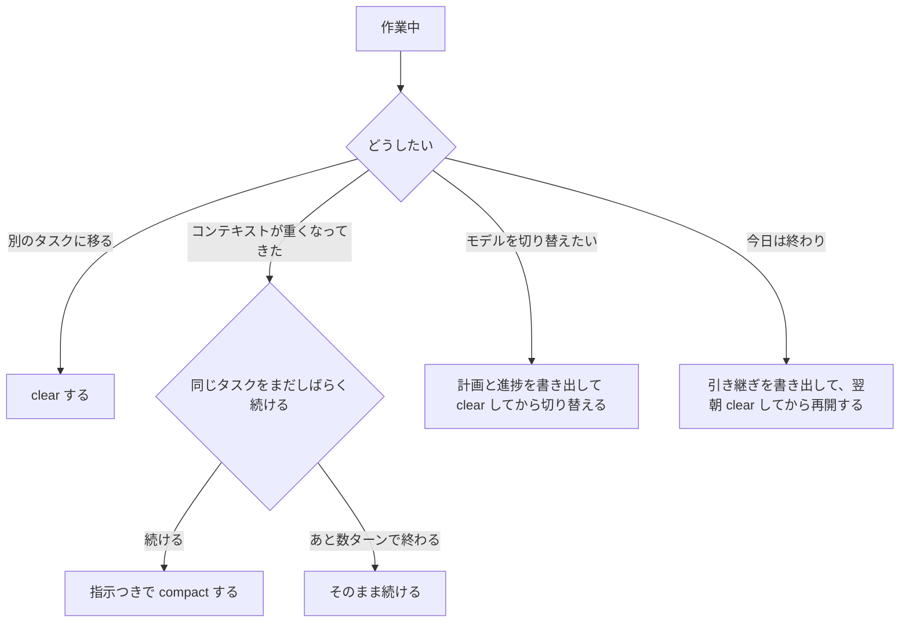

## きっかけ

普段 Claude Code を何となく使っていますが、トークンがどこでどれだけ消費されているのかはあまり意識したことがありませんでした。
普段何気なくやってることがトークンコストの観点で得なのか損なのかも分からないままでした。
そこで仕組みの調査・自分の素朴な疑問点を解消するベースで、開発体験を損なわずにトークンを節約する方法を整理してみました。

## この記事の結論

整理した結果、自分が採用することにしたのは次の4つです。

| やること | 理由 |
| --- | --- |
| 1タスク1セッション。別のタスクに移るときは `/clear` | 関係ない履歴が、毎ターン入力に乗り続けるから |
| `/compact` は、同じタスクをまだしばらく続けるときだけ使う。終わりかけなら使わない | compact 自体が大きなリクエストで、元を取るのに13ターン前後かかるから |
| モデルを切り替えたくなったら、計画や進捗をファイルに書き出して `/clear` してから切り替える | 履歴を抱えたまま切り替えると全履歴の書き込み直しになり、元を取るのに十数ターンかかるから |
| 帰る前に引き継ぎを書き出して、翌朝は `/clear` から始める | キャッシュが有効なうちなら安く、古い情報も持ち越さないから |

記事内で、それぞれの根拠を詳しく見ていきます。

## トークンが消費される仕組み（ざっくり）

### 毎ターン、会話全体が送り直されている

Claude は会話の内容を覚えているわけではないので、それまでの会話全体を毎回入力として受け取っています。
つまり、同じ「1往復」でも、セッションが長くなるほど1回あたりの入力トークンは増えていきます。

入力に乗るものは、大きく2種類に分けられます。

| 種類 | 中身 |
| --- | --- |
| 固定で乗るもの | システムプロンプト、ツール定義、CLAUDE.md、MCP サーバーのツール定義 |
| 積み上がるもの | 自分とのやり取り、読み込んだファイル、コマンドの出力（テストログなど） |

### プロンプトキャッシュのおかげで、実際はそこまで高くない

毎回全部を送り直していると聞くと高そうですが、**前回と同じ先頭部分はキャッシュから安く読める**仕組みがあります。
Claude Code では、これが**デフォルトで自動的に使われています**。

- キャッシュから読む: 通常の入力単価の1/20（Opus 5.5 / Sonnet 5.5 の場合）
- キャッシュに書き込む: 通常の入力単価の2倍（有効期限1時間の場合。5分の場合は1.25倍）
- 最後に使ってから有効期限が過ぎると、キャッシュは切れる

有効期限は使い方で変わります。[Claude Code の公式ドキュメント（Prompt caching）](https://code.claude.com/docs/en/prompt-caching)によると、Claude Code はサブスクリプションのプラン内で使っている場合は**1時間**、API キーや追加の利用クレジットで使っている場合は**5分**です。

自分の環境（サブスクリプション）でログを確かめてみると、実際に1時間が境目になっていました。前のリクエストからの間隔ごとに、キャッシュから読めた割合を集計した結果です。

| 前のリクエストからの間隔 | キャッシュから読めた割合（中央値） |
| --- | --- |
| 5分未満 | 99% |
| 5分〜1時間 | 100% |
| 1時間〜2時間 | 5% |
| 2時間以上 | 8% |

つまり、サブスクリプションなら**1時間以内の休憩ではキャッシュは残っています。** 逆に、翌日の再開では必ず切れています。
この記事の試算は、この「サブスクリプション・有効期限1時間」を前提にしています。

### キャッシュは何を、どの単位で持っているのか

キャッシュは「セッションごと」ではなく、**「モデル」と「入力の中身」**で管理されています。

入力は毎回「ツール定義 → システムプロンプト → 会話履歴 → 今回の入力」の順に並んでいます。キャッシュが使えるのは、このうち**前回のリクエストと、先頭から順番に見てまったく同じ部分**だけです。

例えば、2ターン目のリクエストはこうなります。

| 入力の中身 | 1ターン目にも送ったか | キャッシュ |
| --- | --- | --- |
| ツール定義 | 送った（同じ） | 読める |
| システムプロンプト | 送った（同じ） | 読める |
| 1ターン目の質問と回答 | 送った（同じ） | 読める |
| 2ターン目の質問 | 初めて送る | 書き込む |

会話は後ろに足されていくだけなので、普段は前回までの部分がまるごとキャッシュから読めます。

ただし、途中の1か所でも前回と違うと、**そこから後ろはすべて読めなくなります。** 例えばシステムプロンプトが少しでも変わると、その後ろの会話履歴が前回とまったく同じでも、全部書き込み直しになります。「どこまで前回と同じだったか」を先頭から順に見ていく仕組みなので、途中で違いが出たら、そこで打ち切られるイメージです。

緑がキャッシュから読む部分、赤が新しく書き込む部分です。

中身が同じなら、別のセッションでもキャッシュは共有されます。ツール定義やシステムプロンプトのように、どのセッションでも同じ部分は使い回されています。

キャッシュの中身そのものは見えませんが、どれだけ読み書きされたかは確認できます。
Claude Code は `~/.claude/projects/` 以下に JSONL 形式でログを残していて、リクエストごとに `cache_read_input_tokens`（読んだ量）と `cache_creation_input_tokens`（書き込んだ量）が記録されています。日別・セッション別にざっくり見たいなら、このログを集計してくれる [ccusage](https://github.com/ryoppippi/ccusage)（`npx ccusage@latest`）が手軽です。

:::message
この記事で「ログで確認した」と書いているのは、個人端末のログです。使用量は業務の開発とかなり違うので、使用量の数字は載せず、**キャッシュの挙動の確認にだけ**使っています。
:::

### キャッシュが原因で悪さはしないのか

キャッシュは中身が見えず、自分でクリアすることもないので、意図せず放置したままになります。
そこで気になっていたのが、「放置したキャッシュが回答の精度を下げないか」と「保持しておくこと自体にコストがかからないか」の2つでした。

結論はどちらも**問題ありません。**

- **精度は下がらない**: キャッシュは「前回と完全に同じ部分の計算結果」を使い回しているだけで、余計な情報が足されることはありません。Claude が見ている内容は、キャッシュがあってもなくても同じです
- **保持コストはかからない**: 料金が発生するのは書き込むときと読むときだけで、使わなければ自動で消えます

精度に影響するのは、キャッシュではなく**コンテキスト（会話履歴そのもの）**の方です。

| | キャッシュ | コンテキスト |
| --- | --- | --- |
| 中身は見えるか | 見えない | `/context` で見える |
| 精度への影響 | なし | あり（不要な情報が残ると落ちる） |
| 自分で消す必要 | なし（自動で切れる） | あり（`/clear`、`/compact`） |

キャッシュについて気をつけるべきなのは、「知らないうちに外れて割高になる」ことだけです。[Claude Code の公式ドキュメント](https://code.claude.com/docs/en/prompt-caching)と [Claude API の公式ドキュメント](https://platform.claude.com/docs/en/build-with-claude/prompt-caching)で確認すると、外れる操作と外れない操作は次の通りでした。

| 操作 | キャッシュ |
| --- | --- |
| モデルを切り替える | 外れる（すべて） |
| 有効期限を過ぎて放置する | 外れる（すべて） |
| システムプロンプトが変わる | 外れる（すべて） |
| effort を変える（Opus 5.5 / Sonnet 5.5 などの新しいモデル） | 外れない |
| 途中で MCP サーバーを追加する（ツール検索が有効な場合。デフォルトで有効） | 外れない |
| 途中で CLAUDE.md を編集する | 外れない（ただし、そのセッションには反映されない。下で説明） |

普段の使い方で気にするべきなのは、モデルの切り替えと放置の2つくらいです。

### セッションの途中で CLAUDE.md を編集したらどうなるか

作業中に「これは CLAUDE.md に書いておこう」と編集することがありますが、[公式ドキュメント](https://code.claude.com/docs/en/prompt-caching)によると、**その編集は今のセッションには反映されません。**

- プロジェクト直下とユーザー単位の CLAUDE.md は、セッション開始時に1回だけ読み込まれ、そのまま使われ続ける
- 編集した内容が反映されるのは、次に `/clear`・`/compact`・再起動したとき
- サブディレクトリの CLAUDE.md は、そのディレクトリのファイルを触ったときに初めて読み込まれるので、読み込まれる前の編集なら反映される

コスト面では、編集してもキャッシュは外れないので、**途中で直すこと自体はタダ**です。
ただ、すぐには効かないので、「CLAUDE.md を直したのに Claude が従わない」と感じたら、反映されていないだけかもしれません。CLAUDE.md の修正はタスクの区切りでまとめて行い、`/clear` で反映させるのがちょうどいいと思います。

## モデルごとのコスト差

Claude の主なモデルの API 単価は次の通りです（100万トークンあたり、2026年11月時点。出典: [Pricing](https://platform.claude.com/docs/en/about-claude/pricing)）。

| モデル | 入力 | 出力 | キャッシュ書き込み（1時間） | キャッシュ読み |
| --- | --- | --- | --- | --- |
| Fable 5.1 | $10.00 | $50.00 | $20.00 | $0.25 |
| Opus 5.5 | $4.00 | $20.00 | $8.00 | $0.20 |
| Sonnet 5.5 | $2.00 | $10.00 | $4.00 | $0.10 |
| Haiku 5.5 | $0.10 | $0.50 | $0.20 | $0.01 |

※ Haiku 5.5 は10万トークンまでの単価です。

表を見て気づいたことが3つあります。

1. **キャッシュが効いていれば、入力より出力の方が高くつく**
   Opus 5.5 なら、10万トークンの履歴をキャッシュから読んでも$0.02です。一方で、出力（思考を含む）は2Kトークンで$0.04かかります。長いセッションでも、キャッシュさえ効いていれば、コストの中心は出力になります。
2. **Haiku は桁違いに安い**
   Opus の1/40なので、ちょっとした質問なら Haiku で十分なことも多そうです。
3. **モデル選びと同じくらい、effort（思考の深さ）が効く**
   思考は出力トークンとして課金されるので、同じモデルでも effort の設定で出力量が大きく変わります。

## 文脈集めにどれだけ使っているのか

セッションを始めたときや、ソースコードを読ませて文脈を集めるときに、かなりトークンを使っている気がしていました。

### セッション開始時点で、すでに固定部分が乗っている

何も作業していない最初のリクエストの時点で、システムプロンプト・ツール定義・CLAUDE.md・MCP などの固定部分が乗っています。
入れている MCP サーバーやスキルの数で大きく変わるので、自分の環境の値は `/context` で確認するのが確実です。使っていない MCP サーバーや、肥大化した CLAUDE.md は見直す価値があります。

### 一番効いてくるのは、ファイルの読み込みとコマンドの出力

一度読み込んだファイルや出力は、その後のターンでもずっとコンテキストに残り続けます。
つまり、**最初の文脈集めで読み込んだ量が、そのセッションの残りすべてのターンの重さを決めます。**

節約するなら、次の3つが開発の速さを落とさずにできます。

| 方法 | 効果 |
| --- | --- |
| 依頼するときに、関係するファイルやディレクトリを指定する | 探索のための読み込みが減る |
| CLAUDE.md に「どこに何があるか」を短く書いておく | 毎回の探索が減る（CLAUDE.md は毎ターン乗るが、キャッシュで安い） |
| テストやビルドの出力を絞る | 不要なログがコンテキストに残らない |

### サブエージェントは裏で勝手に起動しているのか

見えないところでサブエージェントが勝手に起動して、トークンを食っている気もしていました。

サブエージェントは、Claude が自分の判断で起動します。ただし完全に裏で動いているわけではなく、起動するときはツール呼び出しとして画面に表示されます。出力が折りたたまれていると見落としやすいだけです。

サブエージェントは親とは別のコンテキストで作業し、親には結果の要約だけを返します。広い調査を任せれば親のコンテキストが膨らまない一方、毎回ゼロから文脈を集めるので、起動しすぎるとその分コストがかさみます。

意外だったのは、調査用の組み込みサブエージェント（Explore）が、デフォルトではメインの会話と同じモデルで動くことです（[公式ドキュメント（Subagents）](https://code.claude.com/docs/en/sub-agents)）。メインが Opus なら、調査も Opus で行われます。

気になる場合は、開発の速さを落とさない範囲で次のような手が打てます。

| 方法 | 強さ | 内容 |
| --- | --- | --- |
| サブエージェントを安いモデルで動かす | 弱 | 環境変数 `CLAUDE_CODE_SUBAGENT_MODEL=haiku` を設定する。カスタムエージェントなら定義に `model: haiku` と書く |
| CLAUDE.md にルールを書く | 弱 | 「サブエージェントは広い調査のときだけ使う」など |
| 起動前に確認を求める | 中 | 権限設定で `Agent` ツールを `ask` にする |

まずは、安いモデルで動かす設定だけで十分だと思います。

## 「作り直し」が起きる3つの場面

ここからは、普段自分が何気なくやっていて「これって損してない？」と気になっていた3つの操作を見ていきます。

- セッションの途中でモデルを切り替える
- `/compact` する
- セッションを放置して、翌日そのまま再開する

この3つはどれも、**キャッシュやコンテキストを作り直す**操作です。
どれも「最初に1回、余分なコストを払う代わりに、その後の1ターンあたりが安くなる」という形をしています。

なので考え方は共通で、**「最初に払った分を、その後の安くなった分で取り戻せるか」**で損得が決まります。
例えば `/compact` に$0.31かかっても、その後1ターンあたり$0.024安くなるなら、13ターン続ければ取り戻せます。逆に、5ターンで作業が終わるなら、払った分を取り戻せずに損をします。

以下の試算は、すべて Opus 5.5 の単価・キャッシュの有効期限1時間を基準にしています（API キーで使う場合は有効期限5分・書き込み1.25倍なので、金額はもう少し下がります）。

### セッション途中のモデル切り替え

**結論: 負担は「切り替えた直後の1回」。ちょっとした用事のために切り替えると元が取れません。**

キャッシュはモデルごとに別管理なので、モデルを切り替えると、次のターンでそれまでの履歴をすべて新しいモデル用に書き込み直すことになります。
一方で、元のモデルのキャッシュは1時間残っているので、1時間以内に戻るなら戻る側の負担はほとんどありません。

ログでも、この挙動を確認できました。

| 操作 | キャッシュから読めた割合 |
| --- | --- |
| Opus → Sonnet に切り替えた直後（約17万トークン） | 14% |
| その3分後に Sonnet → Opus に戻した直後 | 98% |

10万トークンのセッションで試算すると、次の1ターンの入力コストはこうなります。

| 操作 | 次の1ターンの入力コスト |
| --- | --- |
| Opus のまま続ける | 約$0.02 |
| Sonnet に切り替える | 約$0.40 |
| 1時間以内に Opus に戻す | 約$0.02（＋Sonnet で増えた分の書き込み） |
| 1時間以上たって Opus に戻す | 約$0.80 |

Sonnet に切り替えて節約できるのは、1ターンの出力を2Kトークンと仮定すると、出力とキャッシュ読みを合わせて約$0.03です。
つまり、**切り替えで払った分を取り戻すには、十数ターン Sonnet で作業を続ける必要があります。**

切り替えるなら、**セッションの冒頭か `/clear` の直後**にします。コンテキストが小さいうちなら、作り直しの負担はほとんどありません。
作業の途中で切り替えたくなったときは、計画や進捗をファイルに書き出してもらってから `/clear` し、新しいモデルにそのファイルを読ませると、文脈を引き継ぎつつ負担を小さくできます。

### /compact は節約になるのか

自分はよく `/compact` を使うのですが、これが節約になっているのかは正直分かっていませんでした。

**結論: その後も作業を続けるなら得。終わりかけのタイミングでやると損です。**

`/compact` は、それ自体が「全履歴を読んで要約を出力する」1回分のリクエストです。[公式ドキュメント（Manage costs effectively）](https://code.claude.com/docs/en/costs)にも、大きなコンテキストの compact はそれ自体が大きなリクエストになる、と書かれています。要約は出力トークン扱いなので、単価も高めです。
その代わり、終わった後はコンテキストが小さくなり、1ターンあたりのコストが下がります。

要約の大きさの目安として、ログに残っていた自動 compact（1件）を見ると、約40万トークンの履歴が約1.2万トークンの要約になっていました。

これをもとに、15万トークンのセッションで、要約が1万トークン、compact 後のコンテキストが固定部分を含めて3万トークンになると仮定して試算します。

| 操作 | コスト |
| --- | --- |
| そのまま続けた場合の1ターンの入力 | 約$0.03 |
| `/compact` 1回 | 約$0.31（読み込み$0.03 + 要約の出力$0.20 + 要約の書き込み$0.08） |
| compact 後の1ターンの入力 | 約$0.006 |

1ターンあたり約$0.024安くなるので、**この試算では13ターン前後で元が取れます。**
思っていたより取り戻すのに時間がかかるので、「あと数ターンで終わる」タイミングの compact は損です。
また、要約から漏れた情報を取り戻すために Claude がファイルを読み直すことがあり、その分のトークンもかかります。

`/clear` との使い分けは次の通りです。

| 状況 | おすすめ |
| --- | --- |
| 別のタスクに移る | `/clear`（コストゼロで、一番小さくなる） |
| 同じタスクをまだしばらく続ける | 指示つきの `/compact`（例: 「〇〇の実装方針だけ残して」） |
| 同じタスクだが、あと数ターンで終わる | 何もしない（compact しても元が取れない） |

### セッションを何日も使い続けるのはアリか

自分はセッションを閉じずに放置して、翌日そのまま再開することがよくあります。作業が途中のこともありますし、何よりコンテキストが残っている方が早いからです。
結果として、1つのセッションをタスクが終わるまで何日も使い続けています。

**結論: お金の面では大きな損ではありません。問題になるのは、コンテキストの「重さ」と「古さ」です。**

- **再開した最初の1ターンだけ割高になる**
  翌日にはキャッシュが必ず切れているので、全履歴を書き込み直します。15万トークンのセッションなら1日1回約$1.20で、一から説明し直すコストと比べると大差ないこともあります。
- **コンテキストが膨らみ続ける**
  毎ターンの入力が重くなり、自動の compact も発生しやすくなります。そのたびに要約で文脈の精度が少しずつ落ちます。
- **コンテキストの情報が古くなる（一番危ない）**
  pull や他の人の変更があっても、Claude は前日に読んだファイルの内容のまま作業します。**古いコードを前提に編集してしまう**可能性があり、これはトークンではなく品質の問題です。

そこで、「コンテキストがあるから早い」というメリットを残しつつ、重さと古さを避ける運用にすることにしました。

| タイミング | やること |
| --- | --- |
| 帰る前 | 進捗・決まったこと・次にやることをファイルに書き出してもらう |
| 翌朝 | `/clear` してそのファイルを読ませる |
| 再開時 | pull などで変更があれば「関連ファイルを読み直して」と一言添える |

ポイントは、**書き出しを翌朝ではなく帰る前にやること**です。最後の作業から1時間以内ならキャッシュがまだ有効なので、全履歴を安く読めます。

| タイミング | 全履歴（15万トークン）を読むコスト |
| --- | --- |
| 帰る前（キャッシュ有効） | 約$0.03 |
| 翌朝（キャッシュ切れ） | 約$1.20 |

同じ操作でも、タイミングだけで料金が大きく変わります。

## 迷ったら「払った分を取り戻せるか」だけ考える

モデルの切り替えも、`/compact` も、翌日の再開も、損か得かは「最初に払う分を、その後の安くなった分で取り戻せるか」で決まりました。
冒頭の4つは、どれもこの判断基準を普段の開発に当てはめたものです。

作業中に迷いやすい場面を、判断の流れにするとこうなります。

ルールを全部覚えておく必要はなく、迷ったときに「これは払った分を取り戻せるか」と考えるだけで十分です。
そして、トークンの節約は、あくまで開発体験を損なわない範囲でやるものです。まずは自分のログや ccusage で使い方を見てみると、どこを削るべきかが見えてくると感じました。

## 参考

- [Prompt caching - Claude Code Docs](https://code.claude.com/docs/en/prompt-caching)
- [Manage costs effectively - Claude Code Docs](https://code.claude.com/docs/en/costs)
- [Subagents - Claude Code Docs](https://code.claude.com/docs/en/sub-agents)
- [Prompt caching - Claude API Docs](https://platform.claude.com/docs/en/build-with-claude/prompt-caching)
- [Pricing - Claude API Docs](https://platform.claude.com/docs/en/about-claude/pricing)
- [ccusage](https://github.com/ryoppippi/ccusage)
