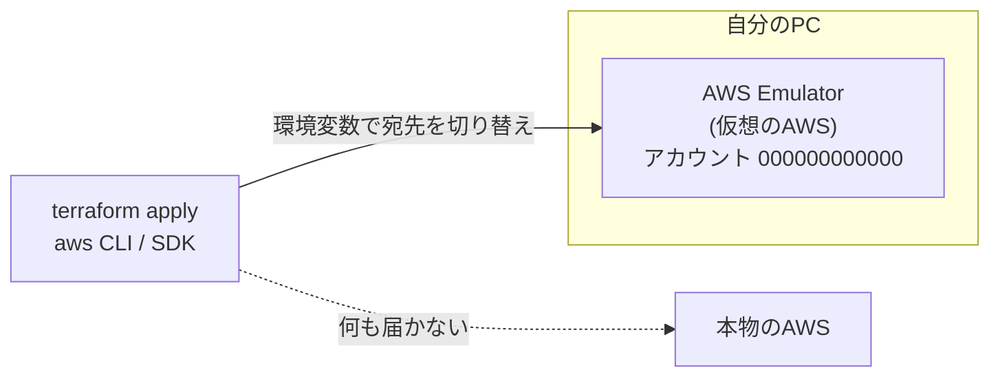
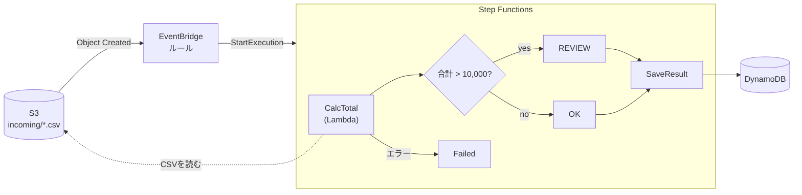
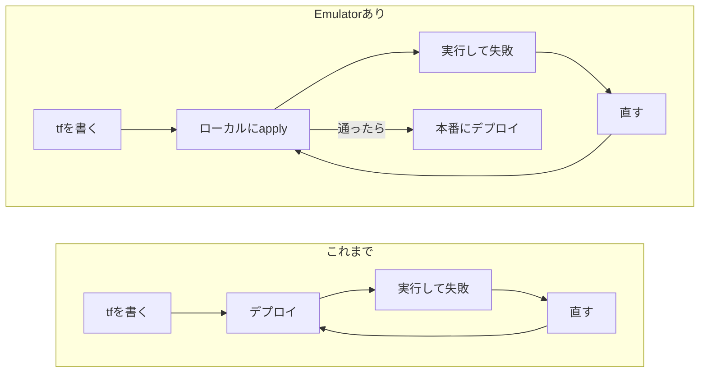
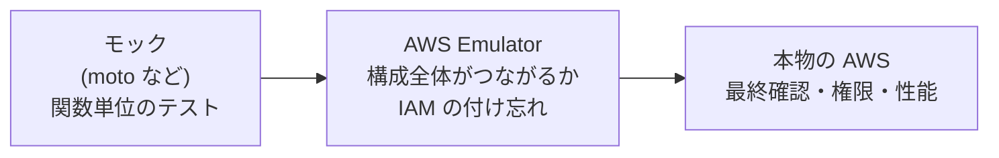

2026年11月11日に **AWS Emulator** が公開されました。

https://aws.amazon.com/jp/about-aws/whats-new/2026/11/aws-emulator-now-available/

発表を読んでも「で、結局なにに使えるの？」がピンとこなかったので、実際に手を動かして確かめました。題材は、S3・Lambda・Step Functions・DynamoDB を組み合わせた構成を Terraform で定義し、**デプロイせずにローカルで動かす** というものです。

この記事で分かること：

- AWS Emulator がどういうものか（図で1枚）
- Terraform の構成がどこまでローカルで動くか
- 使えるところ・使えないところ

## AWS Emulator とは：ローカル用の「捨てられる AWS」

一言でいうと、**手元に立てる、いつでも作って捨てられる仮想の AWS 環境** です。



ふだん本物の AWS に向けている Terraform や AWS CLI の宛先を、環境変数でエミュレーターに切り替えるだけで使えます。**tf やアプリのコードは書き換えません。**

特徴をまとめるとこうです。

- **AWS アカウント不要・追加料金なし**
- **データはメモリ上だけ**。止めると全部消えるので、毎回まっさらから始められる
- **AWS の公開 API 定義から作られている**。リポジトリには 400 を超えるサービスのモジュールがある
- **未対応の操作は `501 Not Implemented` を返す**。黙って成功したふりはしない
- ソースは CC0（パブリックドメイン相当）で[公開](https://github.com/aws/aws-emulator)

注意したいのは、**本物のアカウントにあるリソースをコピーしてくるわけではない** ことです。起動直後は空っぽなので、自分で Terraform などを流してリソースを作ります。

## 試したシナリオ

「注文 CSV を S3 に置くと、自動で集計して DynamoDB に保存する」という構成を作りました。



- Lambda が S3 から CSV を読んで合計金額を計算する
- 金額が 1 万円を超えたら「要確認（REVIEW）」にする
- 結果を DynamoDB に保存する（Step Functions から直接書き込む）
- IAM ロールも含めて、**全部で 13 リソースを Terraform で定義**

## 準備：エミュレーターを起動する

macOS と Windows では、自分で Docker イメージを作って動かします（公開済みのイメージはありません）。Linux なら RPM/Debian パッケージもあります。手順は[公式ドキュメント](https://docs.aws.amazon.com/emulator/latest/userguide/getting-started-docker.html)のとおりです。

:::details Dockerfile（公式ドキュメントのもの）
```dockerfile:Dockerfile
FROM public.ecr.aws/amazonlinux/amazonlinux:2023-minimal
# Apple シリコンは aarch64、Intel Mac / Windows は x86_64
ADD https://downloads.aws.com/aws-emulator/packages/aws-emulator/LTS/latest/aws-emulator-aarch64.rpm /tmp/aws-emulator.rpm
RUN rpm -i /tmp/aws-emulator.rpm && rm /tmp/aws-emulator.rpm \
    && mkdir -p /home/emulator && chown 1000 /home/emulator
USER 1000
ENV HOME=/home/emulator
EXPOSE 9297
ENTRYPOINT ["aws-emulator", "-b", "0.0.0.0"]
```
:::

```bash
docker build -t aws-emulator .
mkdir -p ~/.aws/emulator
docker run --rm --memory=2g --memory-swap=2g -p 127.0.0.1:9297:9297 \
  -e HOME="$HOME" -v "$HOME/.aws/emulator:$HOME/.aws/emulator" \
  aws-emulator -p 9297 --telemetry off
```

起動すると、`~/.aws/emulator/9297/` に **今回の起動でだけ使える認証情報と証明書** が書き出されます。別のターミナルで、次の環境変数を読み込めば宛先が切り替わります。

```bash:emu-env.sh
# 本物の認証情報が残っていると事故の元なので消しておく
unset AWS_ACCESS_KEY_ID AWS_SECRET_ACCESS_KEY AWS_SESSION_TOKEN AWS_PROFILE

export AWS_ENDPOINT_URL=https://127.0.0.1:9297
export AWS_SHARED_CREDENTIALS_FILE=~/.aws/emulator/9297/emulator_credentials
export AWS_CONFIG_FILE=~/.aws/emulator/9297/config
export AWS_CA_BUNDLE=~/.aws/emulator/9297/ca.pem
export AWS_EC2_METADATA_DISABLED=true
export AWS_DISABLE_HOST_PREFIX_INJECTION=true
export AWS_REGION=us-east-1
export AWS_DEFAULT_REGION=us-east-1
```

```bash
$ source emu-env.sh
$ aws sts get-caller-identity --query Account --output text
000000000000
```

`000000000000` と出ればエミュレーターに繋がっています。**自分のアカウント ID が出たら本物の AWS に向いているので、ここで止めてください。**

:::message
`--telemetry off` は利用状況の送信を止めるオプションです。テレメトリーは初期設定でオンになっています。
:::

## Terraform で流して動かす

Lambda は、boto3 で S3 から CSV を読んで合計を返すだけのシンプルなものです。**エミュレーター向けの分岐は入っていません。**

:::details src/order.py（Lambda のコード）
```python:src/order.py
import csv, io, boto3

s3 = boto3.client("s3")

def handler(event, context):
    bucket, key = event["bucket"], event["key"]
    body = s3.get_object(Bucket=bucket, Key=key)["Body"].read().decode()
    total = 0
    for row in csv.DictReader(io.StringIO(body)):
        total += int(row["price"]) * int(row["qty"])
    if total <= 0:
        raise ValueError(f"invalid order: total={total}")
    return {"orderId": key.split("/")[-1].removesuffix(".csv"), "total": total}
```
:::

tf の全文は長いので折りたたんでいます。中身は、ふだん本物の AWS 向けに書くものと同じです。

:::details main.tf（全文）
```hcl:main.tf
terraform {
  required_providers {
    # 2026年11月時点、エミュレーターで S3 バケットを作るには v5 系が必要
    aws     = { source = "hashicorp/aws", version = "~> 5.0" }
    archive = { source = "hashicorp/archive", version = "~> 2.0" }
  }
}

provider "aws" {
  region = "us-east-1"
}

# ---------- S3: 注文CSVの置き場（EventBridge 通知を有効化） ----------
resource "aws_s3_bucket" "orders" {
  bucket = "orders-demo"
}

resource "aws_s3_bucket_notification" "orders" {
  bucket      = aws_s3_bucket.orders.id
  eventbridge = true
}

# ---------- DynamoDB: 集計結果の保存先 ----------
resource "aws_dynamodb_table" "results" {
  name         = "order-results"
  billing_mode = "PAY_PER_REQUEST"
  hash_key     = "orderId"
  attribute {
    name = "orderId"
    type = "S"
  }
  # エミュレーターでは 2 回目以降の apply で差分扱いになるため無視する
  lifecycle {
    ignore_changes = [on_demand_throughput]
  }
}

# ---------- Lambda: CSVを読んで合計を計算 ----------
data "archive_file" "fn" {
  type        = "zip"
  source_dir  = "${path.module}/src"
  output_path = "${path.module}/build/fn.zip"
}

resource "aws_iam_role" "lambda" {
  name = "calc-order-lambda"
  assume_role_policy = jsonencode({
    Version   = "2012-10-17"
    Statement = [{ Effect = "Allow", Principal = { Service = "lambda.amazonaws.com" }, Action = "sts:AssumeRole" }]
  })
}

resource "aws_iam_role_policy" "lambda" {
  role = aws_iam_role.lambda.id
  name = "read-orders"
  policy = jsonencode({
    Version   = "2012-10-17"
    Statement = [{ Effect = "Allow", Action = "s3:GetObject", Resource = "${aws_s3_bucket.orders.arn}/*" }]
  })
}

resource "aws_lambda_function" "calc" {
  function_name    = "calc-order"
  role             = aws_iam_role.lambda.arn
  runtime          = "python3.12"
  handler          = "order.handler"
  filename         = data.archive_file.fn.output_path
  source_code_hash = data.archive_file.fn.output_base64sha256
}

# ---------- Step Functions: 計算 → 分岐 → 保存 ----------
resource "aws_iam_role" "sfn" {
  name = "order-flow-sfn"
  assume_role_policy = jsonencode({
    Version   = "2012-10-17"
    Statement = [{ Effect = "Allow", Principal = { Service = "states.amazonaws.com" }, Action = "sts:AssumeRole" }]
  })
}

resource "aws_iam_role_policy" "sfn" {
  role = aws_iam_role.sfn.id
  name = "order-flow"
  policy = jsonencode({
    Version = "2012-10-17"
    Statement = [
      { Effect = "Allow", Action = "lambda:InvokeFunction", Resource = aws_lambda_function.calc.arn },
      { Effect = "Allow", Action = "dynamodb:PutItem", Resource = aws_dynamodb_table.results.arn },
    ]
  })
}

resource "aws_sfn_state_machine" "order_flow" {
  name     = "order-flow"
  role_arn = aws_iam_role.sfn.arn
  definition = jsonencode({
    StartAt = "CalcTotal"
    States = {
      CalcTotal = {
        Type     = "Task"
        Resource = "arn:aws:states:::lambda:invoke"
        Parameters = {
          FunctionName = aws_lambda_function.calc.arn
          Payload = {
            "bucket.$" = "$.detail.bucket.name"
            "key.$"    = "$.detail.object.key"
          }
        }
        ResultSelector = { "orderId.$" = "$.Payload.orderId", "total.$" = "$.Payload.total" }
        Catch          = [{ ErrorEquals = ["States.ALL"], Next = "Failed" }]
        Next           = "IsBig"
      }
      IsBig = {
        Type    = "Choice"
        Choices = [{ Variable = "$.total", NumericGreaterThan = 10000, Next = "MarkReview" }]
        Default = "MarkOk"
      }
      MarkReview = { Type = "Pass", Result = "REVIEW", ResultPath = "$.status", Next = "SaveResult" }
      MarkOk     = { Type = "Pass", Result = "OK", ResultPath = "$.status", Next = "SaveResult" }
      SaveResult = {
        Type     = "Task"
        Resource = "arn:aws:states:::dynamodb:putItem"
        Parameters = {
          TableName = aws_dynamodb_table.results.name
          Item = {
            orderId = { "S.$" = "$.orderId" }
            total   = { "N.$" = "States.Format('{}', $.total)" }
            status  = { "S.$" = "$.status" }
          }
        }
        End = true
      }
      Failed = { Type = "Fail", Error = "OrderError" }
    }
  })
}

# ---------- EventBridge: incoming/ にCSVが置かれたら起動 ----------
resource "aws_iam_role" "events" {
  name = "order-upload-events"
  assume_role_policy = jsonencode({
    Version   = "2012-10-17"
    Statement = [{ Effect = "Allow", Principal = { Service = "events.amazonaws.com" }, Action = "sts:AssumeRole" }]
  })
}

resource "aws_iam_role_policy" "events" {
  role = aws_iam_role.events.id
  name = "start-order-flow"
  policy = jsonencode({
    Version   = "2012-10-17"
    Statement = [{ Effect = "Allow", Action = "states:StartExecution", Resource = aws_sfn_state_machine.order_flow.arn }]
  })
}

resource "aws_cloudwatch_event_rule" "on_upload" {
  name = "order-uploaded"
  event_pattern = jsonencode({
    source        = ["aws.s3"]
    "detail-type" = ["Object Created"]
    detail = {
      bucket = { name = [aws_s3_bucket.orders.id] }
      object = { key = [{ prefix = "incoming/" }] }
    }
  })
}

resource "aws_cloudwatch_event_target" "sfn" {
  rule     = aws_cloudwatch_event_rule.on_upload.name
  arn      = aws_sfn_state_machine.order_flow.arn
  role_arn = aws_iam_role.events.arn
}

output "state_machine_arn" { value = aws_sfn_state_machine.order_flow.arn }
```
:::

環境変数を読み込んだターミナルで、いつもどおり `apply` します。

```bash
$ source emu-env.sh
$ terraform init
$ terraform apply
...
aws_sfn_state_machine.order_flow: Creation complete
aws_cloudwatch_event_target.sfn: Creation complete
Apply complete! Resources: 13 added, 0 changed, 0 destroyed.
```

あとは本番と同じように、**S3 に CSV を置くだけ** です。

```bash
$ cat order-001.csv
item,price,qty
コーヒー豆,1200,2
マグカップ,800,1

$ aws s3 cp order-001.csv s3://orders-demo/incoming/
$ aws s3 cp order-002.csv s3://orders-demo/incoming/   # 45,000円の注文
$ aws s3 cp order-003.csv s3://orders-demo/incoming/   # マイナス金額の不正データ
```

EventBridge が検知して Step Functions が自動で動き、DynamoDB に結果が入りました。

```bash
$ aws dynamodb scan --table-name order-results \
    --query 'Items[].[orderId.S,total.N,status.S]' --output text
order-001	3200	OK
order-002	45000	REVIEW
```

| 置いたファイル | 結果 |
| --- | --- |
| order-001.csv（3,200円） | ✅ 成功 → `OK` で保存 |
| order-002.csv（45,000円） | ✅ 成功 → 分岐して `REVIEW` で保存 |
| order-003.csv（マイナス金額） | ✅ Lambda の `ValueError` を Catch して FAILED |
| `incoming/` 以外に置いたファイル | ✅ 起動しない（イベントのフィルタが効いている） |

Lambda のコードを直して `terraform apply` し、もう一度 CSV を置く、という修正のループも手元で回せました。

## IAM の設定ミスに、デプロイ前に気づける

個人的に一番驚いたのはここです。エミュレーターは **IAM ロールの権限まで見ています**。

試しに、tf からポリシーの許可を 1 つずつ外して `apply` し、CSV を置いてみました。

| 外した権限 | 結果 |
| --- | --- |
| Step Functions のロールから `lambda:InvokeFunction` | ❌ Lambda を呼べずに失敗 |
| Step Functions のロールから `dynamodb:PutItem` | ❌ DynamoDB に書けずに失敗 |
| Lambda のロールから `s3:GetObject` | ❌ CSV を読めずに失敗 |

どれも、本物の AWS と同じ形のエラーが実行履歴に残ります。

```bash
$ aws stepfunctions get-execution-history --execution-arn $EXEC \
    --query 'events[?type==`TaskFailed`].taskFailedEventDetails.cause' --output text
User: arn:aws:sts::000000000000:assumed-role/order-flow-sfn/order-flow is not authorized to perform:
dynamodb:PutItem on resource: arn:aws:dynamodb:us-east-1:000000000000:table/order-results
because no identity-based policy allows the dynamodb:PutItem action
```

本物の AWS だと「デプロイ → 実行 → 権限エラー → ポリシーを直す → 再デプロイ」の往復になりがちなところを、**デプロイ前に手元で潰せる** わけです。



:::message alert
ただし公式ドキュメントには「IAM ポリシーは AWS と同じようには評価されない。セキュリティのテストには使わないこと」と明記されています。実際、DynamoDB を CLI から直接呼ぶ場合は、権限のないロールでも通ってしまいました。

**「エミュレーターで権限エラーが出たら本物でも出る」とは言えますが、「エミュレーターで通ったから本物でも大丈夫」とは言えません。** 最終確認は本物の AWS で行いましょう。
:::

## 使える・使えないの整理

試した範囲での手応えと、公式が公開している再現度テストの通過率をまとめます。

| サービス | 試した結果 | 公式テストの通過率 |
| --- | --- | --- |
| S3 | ◎ 作成・読み書き・イベント通知まで動いた | 70% |
| Lambda | ◎ Python のコードが実際に動き、中から S3 も読めた | 60% |
| Step Functions | ◎ Lambda 呼び出し・分岐・Catch・DynamoDB 直接書き込みまで動いた | 76% |
| DynamoDB | ◎ 読み書きでき、作成直後の「作成中」状態まで再現 | 70% |
| EventBridge | ◎ S3 のイベントで Step Functions を起動できた | 76% |
| DocumentDB | ✕ クラスターは作れるが、**データベースとして接続できない** | 33% |

※ 通過率は v1.0.348 のリリースに添付された `scores.json` を筆者がサービスごとに集計したもの。不合格の多くはページングや細かいエラーメッセージの違いなどで、今回のような基本的な使い方はすべて動きました。

**向いていること**

- Terraform などで組んだ構成が、**つながって動くか** をデプロイ前に確かめる
- IAM の権限の付け忘れを、手元で見つける
- CI で、AWS の認証情報なしに結合テストを回す

**向いていないこと**

- 本番運用、長時間の運用、負荷テスト（公式に「使わない」と明記）
- セキュリティ・権限が正しいかの最終確認
- DocumentDB など、データ側（実際の DB 接続）が未実装のサービス
- 使っている操作が未対応の場合（`501` が返る）。対応状況は[リリースページ](https://github.com/aws/aws-emulator/releases)で確認できる

もう1つ、公式ドキュメントにある注意も書いておきます。**エミュレーターが動かす Lambda のコードは隔離されず、自分のユーザー権限で PC 上で動きます。** 出どころの分からないコードは動かさないようにしましょう。

## どう使い分けるか

既存の手段と並べると、次のような位置づけになると思います。



モックでは確かめにくい「サービス同士がつながって動くか」を、本物にデプロイする前にお金をかけずに確かめられる層です。本物の AWS での確認がなくなるわけではありませんが、**本物で失敗する回数をかなり減らせそう** だと感じました。

## まとめ

- AWS Emulator は **手元に立てる、捨てられる仮想の AWS**。環境変数で宛先を変えるだけで、tf もコードもそのまま使える
- S3・Lambda・Step Functions・DynamoDB・EventBridge を組み合わせた Terraform 構成が、**ローカルで通しで動いた**
- **IAM の権限ミスまでデプロイ前に見つけられる**。ただし最終確認は本物で
- DocumentDB のように、まだ実用的に使えないサービスもある

まずは「デプロイしてから気づく」系のミスを減らす用途で、気軽に試してみるのがおすすめです。

## 参考

- [AWS Emulator の発表（What's New）](https://aws.amazon.com/jp/about-aws/whats-new/2026/11/aws-emulator-now-available/)
- [AWS Emulator User Guide](https://docs.aws.amazon.com/emulator/latest/userguide/what-is-service.html)
- [Getting started with Docker](https://docs.aws.amazon.com/emulator/latest/userguide/getting-started-docker.html)
- [Pointing your AWS SDK at AWS Emulator](https://docs.aws.amazon.com/emulator/latest/userguide/point-sdk-to-emulator.html)
- [Security in AWS Emulator](https://docs.aws.amazon.com/emulator/latest/userguide/security.html)
- [GitHub: aws/aws-emulator](https://github.com/aws/aws-emulator)
