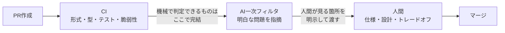
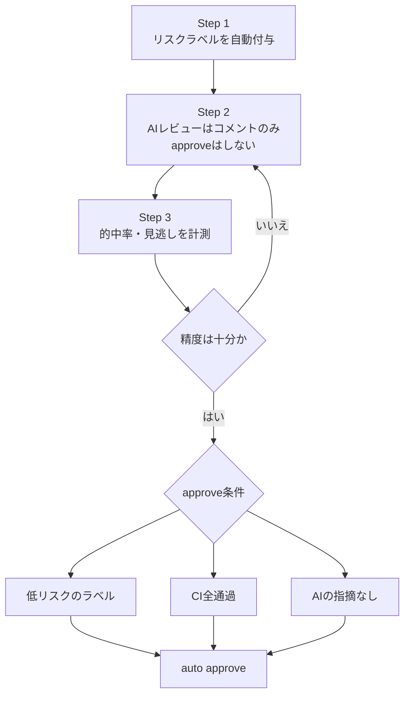

## はじめに

AIでコードを書く量が増えた結果、PRの数もサイズも増えて、**レビューする人間がボトルネック**になってきました。振り返り（KPT）でも「レビューで何を見るかが明文化されておらず、レビュアーごとに確認内容が異なる」というTryが挙がっていました。

そこでチームで、レビューの観点を整理し、**機械（CI）・AI・人間の役割分担**を決めて、少しずつ仕組みに落とし込む取り組みを始めました。

この記事は完成した成功事例ではなく、**途中経過と、そこに至るまでの判断の記録**です。うまくいかなかったこと、やらないと決めたことも含めて残します。

## ゴールの置き方

最初に決めたのは、「何をもって改善完了とするか」でした。

- レビューは完了後も一定は人間が入るので、ゴールが見えにくい
- 速度よりも、**レビュー観点が人に依存しなくなること**を目的にする
- 数値（レビュー開始〜クローズの時間など）は、測っても分かりにくくなるので追いすぎない
- まず「決めたことを実行できたら初期導入完了」とし、その後は継続改善フェーズに移す

そのうえで、作業を次のフェーズに分けて1つのトラッキングIssueで管理しました。

| フェーズ | 内容 |
| --- | --- |
| Phase 0 | 先行して作っていた施策のクローズ・整地 |
| Phase 1 | レビュー観点ドキュメントの作成とチーム合意 |
| Phase 2 | 準備済みのツール導入PRの適用 |
| Phase 3 | 残った論点の調査（4本） |

「完了の定義を先に置く」ことで、終わりのない改善活動になるのを防げました。

## 基本方針：3層で考える

方針はシンプルに3つです。

1. **機械で判定できることはCIに任せ、人間は原則として再確認しない**
2. **AIレビューは一次フィルタ**として使い、明白な問題を人間の前に減らす
3. **人間は、仕様やトレードオフを理解しないと判断できないこと**に集中する

PRが出てから人間に届くまでの流れは、次のイメージです。

この方針に沿って、レビュー観点を洗い出して3層に振り分けました。

## レビュー観点の振り分け

| 観点 | 主な担当 | 現状・方針 |
| --- | --- | --- |
| フォーマット・スタイル | CI | 既存CIで十分 |
| サイズ | CI・ツール | StackedPR＋サイズラベル |
| 複雑さ | CI | linterの複雑度ルール |
| 重複・未使用コード | CI・AI | 未使用検出ツール＋AI |
| 型・明白なバグ | CI・AI | 型チェックで十分。AIにはガイドラインを渡す |
| エラーハンドリング | CI・AI | linter＋AI確認 |
| 依存の脆弱性 | AI | Dependabot/Renovate。AIが古いライブラリを使う対策が必要 |
| 自コードのセキュリティ | SAST・AI | CodeQL、secret scanning、secretlint |
| テスト | CI・AI | CIで実行。不要なテストを書かせない指示が必要 |
| 可読性・保守性 | AI（人間） | linter＋AI。よほどおかしくなければ人間は見ない |
| 後方互換性 | 人間・AI | フロントとバックの同期は重点的に |
| 業務ロジック | 人間・AI | 要件が正しく伝わっているかに注目 |
| 設計・アーキテクチャ | 人間・AI | 依存方向はlintで担保できる範囲を調べる |
| UX | 人間 | デザイン部門のレビューで対応。AI化しない |
| 運用 | 人間・AI | 機械的には見ていない。人間確認と割り切る範囲を明記 |

表を作っていて気づいたのは、「どこまでAIに任せるか」より先に、**「ここは人間が見る」と明記しておく方が大事**ということです。人間が見る場所を書いておかないと、AIが大丈夫と言った箇所を誰も見ない状態になりがちです。

## 観点ごとに話したこと（抜粋）

### サイズ：StackedPRは「大きめPRで効く」

PRが大きくなる問題には、StackedPR（`gh-stack`）を試しました。実際に何度か使ってみて、**大きめのPRでは効果が大きい**という実感があります。一方で課題も見えました。

- stack単位でCIが落ちやすい
- stack単位のテストだと、一気通貫のケースや依存のあるケースが漏れる可能性がある
- レビュー修正時に、その修正がどのstackブランチに属するかを確認する手間がある

PRサイズの問題は、StackedPRで一旦解消とみなし、効果測定して問題が残れば再検討することにしました。課題の解消にはhookやskillでの仕組み化が使えそうなので、これは調査テーマに回しています。

### 業務ロジック：AIに「要件の理解」を説明させる

業務ロジックは、AIのほうが得意な部分もある一方で、**そもそも要件が正しく伝わっているか**が本質です。そこで次のような使い方を考えています。

- AIに要件を説明してもらい、認識がずれていないかを人間が確認する
- AIに要件ベースの問題を作ってもらい、人間が解く（解けない・間違えるなら理解が足りていない）
- 問題と答えを作ってもらうだけでも、ズレに気づけそう

背景には、「人間がそもそもコードを理解しきれなくなっている」という課題があります。

### 後方互換性：AIは「余計な互換」を持たせがち

AIは親切心で、必要のない後方互換を残そうとすることがあります。これを排除したい一方、利用者に影響が出る箇所は念入りに見たい、という両面があります。

- 利用者に影響が出る箇所は、人間とAIの両方で確認
- 開発環境で壊れても確認できる範囲は、割り切る
- フロントとバックの同期は、しっかり確認する

### テスト：カバレッジ閾値は本当に効くのか

当初は「量はカバレッジ閾値、質はカスタム指示」という二本立てを考えていました。しかし議論の中で、

- カバレッジの外にあるものが重要なことが多い
- フロントは、ストーリー単位のカバレッジが取れていない

という指摘が出て、**閾値設定は課題の本質的な解決にならないかもしれない**と整理し直しました。テスト品質をAIレビュー側に寄せる別アプローチを調べることにしています。

## やらなかった判断

取り組みの中で、**やらないと決めたこと**も多くあります。これも成果だと考えています。

- **linterの追加ルール導入**：試した結果、効果が薄いと判断してクローズ
- **フロント・バックのAPI定義同期チェックCI**：コストに見合わないため見送り
- **PRサイズラベルの個別導入**：後述の自動レビューの調査に統合
- **ホスト型のCodexレビュー導入**：導入の手間が大きく、各自がローカルでCodexにレビューさせる形で十分と判断
- **Copilotのカスタム指示の改善**：方針転換（次節）

先に動かしてみたPRを、観点ドキュメントができてから整理し直したことで、「作ったけれど入れない」ものを判断できました。

## 方針転換：カスタム指示から、汎用的なレビューの仕組みへ

最初は、既存のCopilotレビューにカスタム指示を追加して精度を見る、という方針でした。しかし、チームで話すうちに次の理由で方針を変えました。

- Copilotのカスタム指示は、モデルが固定で、ローカルのレビューには使えない
- そもそも指示ファイルをどこまで読んでいるか分からず、CLIで実行したほうが確実かもしれない
- 指摘内容を自分たちでカスタマイズしたい（AIと人間の棲み分けを制御したい）

そこで、**レビュー観点を1つの正ドキュメントとして置き、そこからAIレビューを呼び出す**形に寄せました。観点ドキュメントをリポジトリのルートに配置し、チームで合意してからマージしています。

さらに、レビューは次の2点を意識しています。

- **書いたモデルとは別のモデル、別のコンテキストでレビューさせる**（同じモデルでもコンテキストを分ける）
- **「ここは人間が確認してください」をAIに出力させる**

現在は、チームのレビュー観点を与えた、**外部から呼び出せるレビューAI（チーム専用）**を作っているところです。チーム内で配布できる形に切り出せれば、他のチームにも横展開できると考えています。

## 残りの調査テーマ

初期導入のあとに残った論点は、4つの調査として切り出しました。

| 調査 | 内容 |
| --- | --- |
| A：汎用レビューの仕組み | 観点ドキュメントを入力に、CLIでレビューさせる。配布形態、Claude Codeのレビュー機能も検証 |
| B：StackedPRの仕組み化 | hook／skillで、PR作成時の判定や後付けstack化を自動化できるか |
| C：テスト品質の別アプローチ | カバレッジ以外の方法、AIレビューに寄せる案 |
| D：小型PRの自動レビューとapprove | リスクのラベル付けとAIレビューで、低リスクなPRを人間なしで通せるか |

Dは特に慎重に進めています。いきなりapproveさせるのではなく、**まずコメントのみで運用して、AIの指摘の的中率と見逃しを計測**します。そのうえで、「低リスクと判定されたラベル」「CI全通過」「AI指摘なし」の条件がそろったときだけauto approveを検討する、という段階を踏みます。

## 途中でわかったこと

1. **完了の定義を最初に置く**と、継続改善に流れず区切りをつけられる
2. **「人間が見る場所」を明文化する**ことが、AIに任せる範囲を決めるより先
3. **やらない判断**も成果。作ったものを入れない勇気が要る
4. 指示ファイルは読まれていないかもしれないので、**呼び出し方（CLI／skill）**も含めて設計する
5. **カバレッジのような指標は、課題の本質とずれる**ことがある

## おわりに

まだ効果検証はこれからで、「レビューが楽になった」と言える段階ではありません。ただ、観点を言語化して役割を分けたことで、**何を機械に任せ、何を人間が見るか**をチームで共通認識にできたのは大きいと感じています。

数週間運用して効果を検証してみようと思います。
